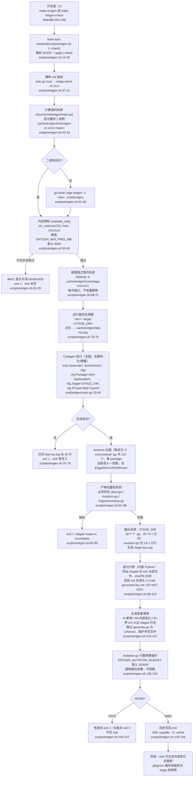
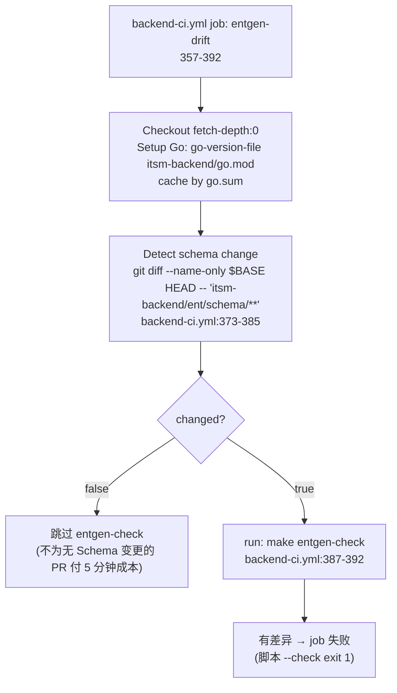
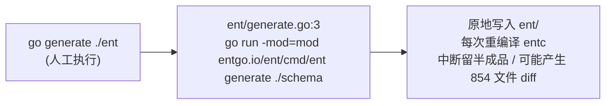

# Ent Codegen 当前真实生成流程（Mermaid）

> 本图只描述**当前代码里实际发生**的步骤，不虚构不存在的环节。
> 图中每个节点都标注了对应文件路径 / 行号 / 命令，便于逐项核对。
> 审查日期：2026-11-21。

---

## 1. 主流程：`make entgen` / `make entgen-check`

**图中明确不存在（不要虚构）的环节**：无 Schema 级变更检测（生成侧）、无依赖分析 / 任务图、无 gofmt 显式调用、无 go build / go vet / go test、无生成结果 git diff 断言、无写回锁。这些环节的缺失是本次评估的结论之一，而非图中省略。

---

## 2. CI 一致性校验流程（仅 Schema 变化时）

**CI 覆盖缺口**：`git diff` 的 pathspec 只有 `itsm-backend/ent/schema/**`。修改 `go.mod` 的 `entgo.io/ent` 版本、`cmd/entgen/main.go`、`scripts/entgen.sh` 或 `ent/` 下手写文件**不会触发** `entgen-check`。

---

## 3. 旧入口（仍在仓库，非当前流程）

该路径与 `make entgen` **无调用关系**；保留仅为兼容旧脚本（runbook「方式 B：项目旧入口，不推荐」）。

---

## 4. 关键路径对照表

| 环节 | 文件 / 命令 | 现状 |
|---|---|---|
| 生成入口 | `Makefile:264-268` → `scripts/entgen.sh` | 有 |
| Schema 扫描 | `entc.Generate("./ent/schema", cfg)` @ `cmd/entgen/main.go:40` | 有（全量，非增量） |
| 变更检测（生成侧） | — | **无**（每次全量生成） |
| 变更检测（写回侧） | SHA-256 @ `scripts/entgen.sh:99-127` | 有 |
| 依赖分析 | — | **无**（单图天然包含全部依赖） |
| Codegen 执行 | `entc.Generate`，cfg 固定 Package/Target/IDType | 有 |
| 输出目录 | `.cache/entgen/runs/stage-XXXXXX`（gitignore） | 有 |
| 格式化 | entc 内置模板默认 gofmt | 无显式步骤 |
| 编译 / 测试 | —（CI 有独立 job，但不在生成链） | 生成链内无 |
| CI 校验 | `backend-ci.yml:357-392`，仅 Schema 路径变化触发 | 有（覆盖面窄） |
