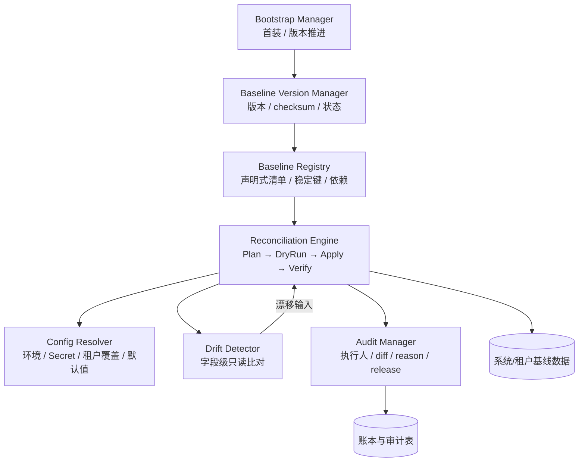

# CloudMesh 系统基线目标架构设计

> 阶段：第二阶段（设计目标架构）  
> 日期：2026-11-21  
> 状态：**设计稿，未实施**。本文档不新增 Ent Schema、不生成代码、不执行迁移。  
> 前置证据：`docs/engineering/system-bootstrap-analysis.md`（第一阶段只读审查）。

## 0. 设计原则

1. **先复用，后新增**：现有初始化引擎、版本化迁移、租约/fencing、租户账本、组件 checksum、只读审计已经可用；新模块只补「声明式基线 + 字段所有权 + 差异协调 + 审计闭环」，不重写执行引擎。
2. **首装与升级分离**：`Bootstrap Manager` 只负责首装/版本推进；`Reconciliation Engine` 负责每个版本的差异协调。二者共用同一账本，但阶段不同。
3. **不覆盖管理员数据**：由数据所有权决定升级行为，而不是由代码里零散的 `if exists` 决定。
4. **默认不物理删除**：协调动作只有 `create / update / skip / deprecate`；`deprecate` 是打标 + 审批，不是 `DELETE`。
5. **生产数据变更需人工审批**：任何结构变更或生产数据回填都先出迁移计划，审批后再执行。

---

## 1. 目标架构总览

### 模块与现有能力的对应关系

| 新模块 | 复用现有 | 新增职责 |
|:--|:--|:--|
| Bootstrap Manager | `boot.RunInitialization`、`cmd/initialize`、`initialization.Engine` | 首装/升级阶段判定；入口统一；拒绝 Web 进程做 DDL/Seed |
| Baseline Registry | `pkg/menubaseline`、`internal/authz`、`manifest_definitions.go`、`config/seed/*.json` | 统一清单结构：稳定键、依赖、资源类型、所有权、字段 ownership、版本 |
| Baseline Version Manager | `schema_migrations`、`initialization_installations`、component checksum | 声明式版本推进、降级拒绝、checksum 绑定、目标版本决策 |
| Reconciliation Engine | `Engine.Plan/Apply/Verify`、lease/heartbeat/fencing | 五态动作、三方合并、dry-run、冲突 fail-closed |
| Config Resolver | `internal/config`、env 绑定、`handlers/systemconfig` | 优先级解析、Secret 引用、URL SSRF 校验、来源可追溯 |
| Drift Detector | `AuditTenantBaselines`、`VerifyTenantBaseline` | 字段级漂移、孤儿/弃用识别、只读报告落库 |
| Audit Manager | `initialization_runs/attempts`、`process_audit_log` 的 before/after 模式 | 基线专属 diff、dry-run 结果、actor/reason/release 全留存 |

---

## 2. 模块职责

### 2.1 Bootstrap Manager

- **入口**：`cloudmesh bootstrap`；底层复用 `cmd/initialize` 的 `apply/retry/status/verify`，不新起一套执行器。
- **职责**：
  1. 判定当前是首装（无平台基线记录）还是升级（已有记录且目标版本更高）。
  2. 首装：结构迁移 → 平台级基线 → 首管引导 → 首个业务租户开通 → Verify。
  3. 升级：只推进版本并触发 Reconciliation；不重建库、不重置密码、不批量删历史数据。
  4. 强制 `SystemContext(reason/release/component)`，所有 bypass 由 Audit Manager 记录。
- **不做**：不直接写业务行；不在 Web 进程执行；不创建工单/事件/CI/通知样例。

### 2.2 Baseline Registry

- 声明式清单的来源收敛为「注册表 + 适配器」：现有 Go 清单、JSON、BPMN 文件作为 adapter 输入，逐步迁移，不一次性重写。
- 每个条目至少包含：
  - `resourceType`（menu / permission / role_grant / config / ticket_type / workflow / template / skill …）
  - `stableKey`（业务键，不用自增 ID 或显示名）
  - `scope`（platform / tenant）
  - `ownership`（system-managed / system-default）
  - `managedFields`（系统托管的字段列表）
  - `dependencies`（稳定键列表，用于 DAG 排序）
  - `deprecatedSince` / `tombstoneKey`
- 约束：同一 `(scope, resourceType, stableKey)` 不得重复注册；别名通过 `stable_key_aliases` 解析，不靠改名匹配。

### 2.3 Baseline Version Manager

- 目标版本来自发布制品的 manifest；当前版本来自 `SystemBaselineRecord`。
- 规则：
  - 只在目标版本 > 当前版本时推进；相等则走幂等校验；小于则拒绝（降级需显式审批与迁移计划）。
  - 版本绑定 manifest checksum 与 release version；checksum 不符 fail closed。
  - 每个 `(scope_type, scope_id, component)` 独立记录，租户升级失败不影响其他租户。
- 与 `schema_migrations` 的关系：结构版本与基线版本分别记账，但同一次发布报告中同时列出。

### 2.4 Reconciliation Engine

- 输入：Registry 清单 + 当前数据库状态 + Config Resolver 的有效值 + 上一次 applied hash。
- 输出动作（替代现有单一 `Action{Type,SourceKey,Summary}`）：

| 动作 | 语义 | 物理删除 |
|:--|:--|:--|
| `create` | 稳定键不存在，按基线创建并写 ownership | 否 |
| `update` | 仅更新 `managedFields` 中「上次应用值与当前值一致」的字段 | 否 |
| `skip` | 无差异，或字段属于 user-managed 且不可覆盖 | 否 |
| `deprecate` | 基线已移除但仍有引用：打弃用标记、停止新引用、进入人工审批队列 | **否** |

- 三方合并：旧系统值、租户当前值、新系统值。若非托管字段被改 → `skip` 并报漂移；若托管字段被改且有系统升级 → `conflict`，默认停止该组件并记审计，不静默覆盖。
- 保证：组件级事务、组件间 DAG 依赖排序、租约 + 心跳 + fencing、失败记录与 `retry` 恢复、同版本重复执行零写入。

### 2.5 Config Resolver

优先级（高到低）：

1. **Secret 引用**：来自环境变量/Secret Manager/K8s Secret，不进普通配置表；
2. **部署环境变量**：如 `ITSM_BOOTSTRAP_ONLY`、`DEPLOYMENT_MODE`、`RLS_MODE`；
3. **租户/用户覆盖**：`ConfigOverride`，属 user-managed；
4. **基线系统默认值**：`system-default`，首次写入，后续不覆盖用户值；
5. **代码内置默认值**：仅兜底，不写库。

- 每次解析返回 `value + provenance`，由 Audit Manager 记录。
- `systemUrl`、SSO、Webhook、Connector 等外部 URL 统一走 SSRF 校验：复用 `service/bpmn/webhook_handler.go:70` 的校验能力，拒绝私网/回环/链路本地/元数据地址，除非显式白名单。
- `smtpPassword` 等敏感键从 `system_configs` 迁出，改为 secret 引用字段。

### 2.6 Drift Detector

- 只读，输出结构化报告：
  - `missing`（稳定键缺失）
  - `field_modified`（托管字段被改）
  - `orphan`（基线已移除但仍存在）
  - `deprecated`（已弃用仍被引用）
  - `checksum_mismatch`（清单与账本不一致）
- 报告既供 `cloudmesh system drift` 输出，也供 `reconcile --dry-run` 复用，避免两套比对逻辑。
- 结果落 `ConfigAuditEvent`（`dry_run=true`），不直接改数据。

### 2.7 Audit Manager

- 记录粒度：一次 run、一个 scope/component、一个动作、一个字段 diff。
- 必备字段：`actor`、`reason`、`release_version`、`target_version`、`scope_type/scope_id`、`component`、`stable_key`、`action`、`before`、`after`、`dry_run`、`result`、`error`。
- 追加写，不更新历史 attempt；与现有 `initialization_runs/attempts` 通过 `run_id` 关联，避免两份执行历史。

---

## 3. 数据所有权模型

| 所有权 | 定义 | 升级行为 | 用户侧表现 | 典型例子 |
|:--|:--|:--|:--|:--|
| **system-managed** | 系统完全拥有字段语义与取值 | 以基线为准；被改动判 `conflict`，需审批后修复 | 用户不可编辑；编辑接口拒绝 | 权限码、resource/action、路由 ACL、内置 Skill code/checksum、稳定键本身 |
| **system-default** | 系统给出初始值，用户可改 | 只新增新键/新版本；**不覆盖已有用户值**；改动记为漂移但自动 `skip` | 用户可编辑，界面标注「系统默认，可自定义」 | 菜单名/图标/排序、系统 URL、工单类型显示名、默认流程绑定、系统配置值 |
| **user-managed** | 用户/租户创建并拥有 | 系统永不更新、永不删除；只可 `deprecate` 并审批 | 完全可编辑 | 自定义角色、自定义菜单、租户自定义配置、个人设置、保存视图 |

### 字段级所有权

单行资源可以同时包含三类字段。每个 `SystemBaselineItem.managedFields` 明确列出系统托管字段；未列入的字段视为 user-managed。三方合并只比较托管字段，并用 `lastAppliedHash` 判断「当前值是否仍等于系统上次写入值」：

- 相等 → 可安全 `update`；
- 不等 → user-managed 改动 → `skip` + 漂移报告；
- 不等且系统新版本也要改该字段 → `conflict`，停止该组件。

稳定键本身属于 `system-managed`；显示名、描述、排序、可见性默认归 `system-default`。

---

## 4. 系统级 / 租户级 / 用户级数据边界

| 层级 | 范围 | 典型数据 | 写入方 | 隔离规则 |
|:--|:--|:--|:--|:--|
| **系统级（platform）** | 全平台唯一，`scope=(platform,0)` | 权限目录、内置角色定义、内置 Skill、基线清单与版本、BootstrapState、发布 checksum | 仅 Bootstrap Manager，经 `SystemContext` | 不接收普通用户请求；任何写入必须带 reason/release/component 并审计 |
| **租户级（tenant）** | 每租户一份，`tenant_id > 0` | 菜单实例、角色实例、角色授权、系统配置、工单类型、流程/模板版本、SLA、CMDB 元模型 | Reconciliation Engine（系统默认值）+ 租户管理员（覆盖值） | `tenant_id` 必填；RLS enforce；跨租户读写一律禁止，除显式 system bypass |
| **用户级（user）** | 个人所有，`owner_user_id` | 个人偏好、保存视图、API token、通知设置、私有工单视图 | 用户本人 | 系统基线永不触碰；不参与协调；不跨租户复制 |

补充说明：租户管理员创建的「自定义角色/菜单/配置」在所有权上属于 **user-managed**，但在数据边界上仍是**租户级**——系统不改其内容，但必须按 `tenant_id` 隔离。

---

## 5. 数据模型规划（第三阶段，待确认后实施）

六个 Ent Schema 的职责边界如下。**不复制现有 `initialization_*` 表的执行历史**：

| Schema | 用途 | 关键字段（规划） | 唯一约束 / 索引 | 与现有表的关系 |
|:--|:--|:--|:--|:--|
| `SystemBaseline` | 声明式基线清单（期望状态） | `scope_type`、`scope_id`、`version`、`manifest_checksum`、`release_version`、`status`、`dependencies` | `(scope_type, scope_id, version)` | 新增；描述「应该是什么」 |
| `SystemBaselineRecord` | 每 scope/component 的已安装声明状态与字段所有权 | `scope_type`、`scope_id`、`component`、`installed_version`、`last_applied_hash`、`managed_fields` | `(scope_type, scope_id, component)` | 与 `initialization_installations` 对齐；后者保留执行历史，本表只存期望/所有权 |
| `SystemBaselineItem` | 基线条目与稳定键映射 | `baseline_id`、`resource_type`、`stable_key`、`ownership`、`deprecated_since`、`alias` | `(baseline_id, resource_type, stable_key)` | 新增；替代散落的 code/path 匹配 |
| `ConfigOverride` | 用户/租户配置覆盖与 Secret 引用 | `scope_type`、`scope_id`、`key`、`value` / `secret_ref`、`owner`、`provenance` | `(scope_type, scope_id, key)` | 与 `system_configs` 分工：前者只存覆盖，后者保留系统默认值 |
| `BootstrapState` | 启动/协调阶段状态快照 | `scope_type`、`scope_id`、`component`、`phase`、`fencing_token`、`error_code` | `(scope_type, scope_id, component)` | 不替代 `sql_store` 租约；只做可查询状态投影 |
| `ConfigAuditEvent` | 追加写审计与 diff | `run_id`、`scope`、`stable_key`、`action`、`before`、`after`、`dry_run`、`actor`、`reason`、`release` | 按 `(scope, created_at)` 索引 | 与 `initialization_runs/attempts` 通过 `run_id` 关联 |

稳定键与唯一约束随资源落到现有表：菜单 `(tenant_id, path)`、角色/权限/工单类型 `(tenant_id, code)`、流程/模板 `(tenant_id, key, version)`、系统配置 `(tenant_id, key)`。同时修 `permission_definition / role_permission / endpoint_acl` 三个 `Index()` 拼写（`Indexes()` 才被 Ent 识别）；经 Ent 代码生成门禁后重生成。

---

## 6. CLI 与命令映射（第四阶段）

| 命令 | 底层复用 | 行为 |
|:--|:--|:--|
| `cloudmesh bootstrap` | `cmd/initialize apply` + Bootstrap Manager | 首装或升级；生产数据变更需审批标记 |
| `cloudmesh system reconcile --dry-run` | `Engine.Plan` + Drift Detector | 只输出五态动作与字段 diff；**零数据库写入** |
| `cloudmesh system reconcile --apply` | `Engine.Apply` + Reconciliation Engine | 按 DAG、事务、租约执行；无物理删除 |
| `cloudmesh system status` | `store.Status` + BootstrapState | 显示版本、组件状态、上次 run |
| `cloudmesh system drift` | `AuditTenantBaselines` + Drift Detector | 只读漂移报告，支持按租户/组件过滤 |

---

## 7. 安全约束映射（第五阶段）

| 约束 | 设计落点 |
|:--|:--|
| 初始管理员密码不入库到代码仓库 | 只用 `ADMIN_PASSWORD` 环境变量或一次性 token；代码中无默认口令；弱口令闸门保留 |
| Bootstrap Token 一次性/严格有效期 | 生成与消费分离，消费即失效；复用现有 token manager，补 TTL 与重放测试 |
| 权限定义与角色授权分离 | `internal/authz` 目录只定义权限码；授权只写 `role_permissions`，两者不互相推断 |
| 新增权限不自动授权给所有用户 | 新增 code 不自动进任何角色；需要授权必须出现在显式发布授权清单并经审批 |
| 自定义角色不被系统基线覆盖 | 自定义角色 `ownership=user-managed`；只匹配稳定键，改名/改码后视为独立资源 |
| Secret 不进普通配置表 | `ConfigOverride.secret_ref` 指向环境变量/Secret Manager；`smtpPassword` 等迁出 `system_configs` |
| 外部 URL 做 SSRF 风险控制 | Config Resolver 统一校验；复用 webhook/SSO 的 URL 校验；拒绝私网/元数据地址 |
| 多租户强制隔离 | `tenant_id` 必填 + RLS enforce + tenantctx；bypass 只在 bootstrap 且带审计 |
| 配置变更留操作人与审计 | 所有 apply 写 `ConfigAuditEvent`；dry-run 也写但标记 `dry_run=true` |

---

## 8. 分阶段实施与验收映射（实施计划，待确认）

| 阶段 | 交付 | 验收 | 状态 |
|:--|:--|:--|:--|
| 1 | `docs/engineering/system-bootstrap-analysis.md` | 覆盖入口、来源、关联、顺序、重复/升级风险；不改实现 | **本轮完成** |
| 2 | `docs/engineering/system-baseline-design.md` | 七模块、三类所有权、三层边界定义完毕 | **本轮完成** |
| 3 | 六个 Ent Schema + 唯一约束 + 生成代码 + 迁移计划 | `make entgen-check`；空卷首装门禁；**迁移计划人工审批后才执行** | 待确认 |
| 4 | Reconciliation Engine + 5 条 CLI | 幂等、事务、锁、DAG、失败恢复；无物理删除 | 待阶段 3 |
| 5 | 安全约束落地 | 9 项约束逐条有测试或审计证据 | 待阶段 4 |
| 6 | 13 类测试矩阵 | 全绿；dry-run 零写入；多租户隔离 | 待阶段 5 |

阶段 6 必须覆盖：首次初始化、重复初始化、同版本重复协调、新版本加菜单、新版本加权限、管理员改系统默认菜单、租户自定义角色、用户自定义配置、环境 URL 不同、并发协调、中途失败恢复、多租户隔离、Dry Run 零写入。

### 明确的前置门槛

1. **未确认前不进入阶段 3**：不写 Ent Schema、不重生成 Ent 代码、不写迁移、不跑生产数据回填。
2. 阶段 3 开始时先出**迁移计划**（表结构、字段映射、回填策略、回滚方案、影响面），人工审批通过后才执行。
3. 每阶段结束跑该阶段相关测试；不批量删除历史基线数据；不重建生产数据库。
4. 保持 Go + Ent + PostgreSQL 技术栈；新代码优先放在现有 `cmd/initialize`、`pkg/seeder`、`internal/initialization` 扩展点内。

---

## 9. 未决项

1. `SystemBaselineRecord` 与现有 `initialization_installations` 是否长期并存，还是最终合并为单一表——需在阶段 3 迁移计划中定稿；当前设计按「并存但单一写入方」处理。
2. `ConfigOverride` 与 `system_configs` 的读写边界需要前端表单联动，属于阶段 3/4 的跨端改动。
3. 旧 `sql/init_data.sql` 与退役 ACL 迁移是归档还是删除，属于历史数据治理，本方案不自动处理。
4. K8s 迁移 Job 错线（`./main migrate`）属于现网缺陷，建议单独修复，不与基线改造混在一个提交。

> 本轮到此为止：仅新增本文档，未修改实现、未生成代码、未执行迁移。
